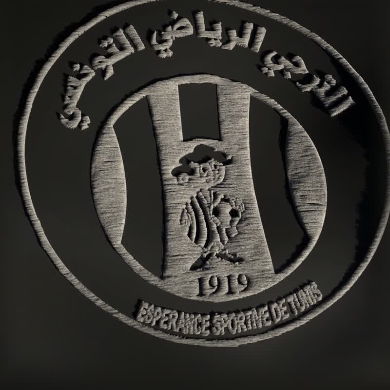
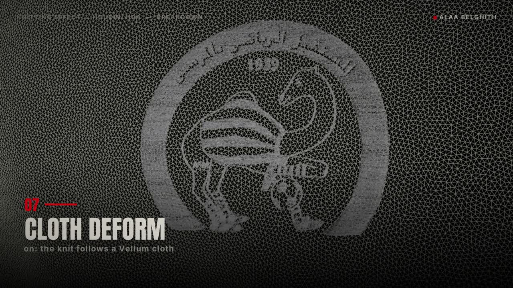

# houdini-hdas

Houdini digital assets I built and published. Each one is a procedural tool with exposed
parameters — drop it in a SOP network and drive it. Written with VEX inside, no Python
dependency.

The first six are also on [Gumroad](https://belguithala.gumroad.com) with a video demo each.
47 downloads to date.

| Asset | What it does | Demo | Gumroad |
|---|---|---|---|
| `alaa_greeble` | Greebling — recursive panel detail across any surface | [video](https://www.youtube.com/watch?v=M21rUnqC2BE) | [get](https://belguithala.gumroad.com/l/mfdsj) |
| `alaa.scattered_effect` | Controlled scatter / disintegration of geometry | [video](https://www.youtube.com/watch?v=A7yQEYU_clM) | [get](https://belguithala.gumroad.com/l/mcrha) |
| `alaa.reaction_diffusion_growth` | Gray-Scott reaction diffusion driving surface growth | [video](https://www.youtube.com/watch?v=nc0F1iwYiyc) | [get](https://belguithala.gumroad.com/l/flszgv) |
| `alaa.curve_flow` | Flow and animation along arbitrary curves | [video](https://www.youtube.com/watch?v=V3V1r1GGlsM) | [get](https://belguithala.gumroad.com/l/uhovo) |
| `alaa.adaptive_subdivision_along_curve` | Adaptive subdivision driven by a curve | [video](https://www.youtube.com/watch?v=oWohBEz2QqI) | [get](https://belguithala.gumroad.com/l/rzuax) |
| `alaa.pinArt_ray` | Pin-art displacement by raycast against a target | [video](https://www.youtube.com/watch?v=_dMXA6TjH3E) | [get](https://belguithala.gumroad.com/l/vafbc) |
| `alaa.knitting_effect` | Grows any logo as knitted cloth — stitches, twisted yarn, optional Vellum cloth deform | [breakdown](https://youtu.be/14s0GIi05p4) · [film](https://youtu.be/gds9RC5kdxs) | free here |

## New — `alaa.knitting_effect`

Feed it a logo (traced to vectors, as polygons) and it grows the logo as knitted cloth: a radius
and remap ramp drive the reveal, the stitches get rows, randomness and noise, and the yarn is swept
and twisted into real strands. Switch **Cloth Deform** on and the knitted logo follows a Vellum cloth.

Made for the [Tunisian Ligue 1 roll call](https://youtu.be/gds9RC5kdxs): 18 crests, one node,
rendered in Karma in a single scripted batch. Breakdown: [YouTube](https://youtu.be/14s0GIi05p4).

| Input | What goes in |
|---|---|
| 1 · `geo` | The logo — closed polygons (trace a PNG to curves, fill) |
| 2 · `reveal` | Geometry the reveal grows from (distance drives the radius) |
| 3 · `cloth_rest` | Optional — cloth at rest, for Cloth Deform |
| 4 · `cloth_anim` | Optional — animated cloth (e.g. a Vellum I/O cache) |

| Parameter panel | Controls |
|---|---|
| Cloth Deform | Off = flat knit · On = knit deformed by inputs 3 + 4 |
| Segments | Resolution of the stitches |
| reveal_settings | Radius + remap ramp — how the knit grows over time |
| knit_settings | Stitch pattern ramps, mask, range, random seed |
| noise_settings | Noise type, frequency, amplitude, roughness, turbulence |
| knit_shape | Columns, strand radius, roll / yaw / pitch twists |
| knit_geo | Yarn radius, width, twist of the final swept strands |

## Install

Copy the `.hda` files into your Houdini otls directory:

- Windows — `C:\Users\<you>\Documents\houdini<version>\otls\`
- macOS — `~/Library/Preferences/houdini/<version>/otls/`
- Linux — `~/houdini<version>/otls/`

Restart Houdini, or **Assets → Install Asset Library** and point at the file. The nodes
appear in the SOP tab menu.

Built in Houdini 20.5. Licensed MIT — use them in commercial work.

---
Alaa Belghith — Houdini FX / 3D generalist. [Portfolio](https://alaabelghith.github.io) ·
[ArtStation](https://artstation.com/alabelguith)
